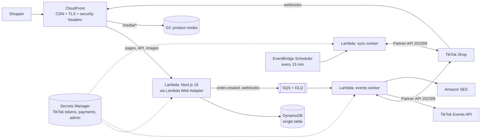

# Mall of Anitoy — storefront

E-commerce website for **[Mall of Anitoy (@leduyenminh)](https://www.tiktok.com/@leduyenminh)**, the TikTok shop for chibi anime figures (Frieren, Fern, Stark, Kinako/Osakana neko…). It runs serverless on AWS and stays in sync with **TikTok Shop**.

- **Four themes**: Light, Dark, **Windows 95** (bevelled windows, title bars, taskbar with a working Start menu) and **Frutiger Aero** (sky, bubbles, frosted glass, glossy buttons). The theme follows the system by default, is saved per visitor, and is applied before first paint.
- **Vietnamese first, English second**: `/` is Vietnamese, `/en` is English. Prices are in VND, addresses use the 34 provinces in place since 1 July 2025, and payment mirrors TikTok Shop Vietnam: COD, ZaloPay, MoMo, Visa/Mastercard/JCB and ATM cards (each online method appears once its gateway keys are set), plus optional VietQR transfer.
- **Built for selling**: pages are CDN-cached and incrementally regenerated, images go through AVIF/WebP optimisation, and pages carry JSON-LD (Product, Breadcrumb, FAQ, OnlineStore), a sitemap and hreflang. The shop also has instant search and filters, a free-shipping progress meter, low-stock badges, quick-add, a sticky mobile buy bar, guest checkout and click-to-play TikTok videos.
- **TikTok Shop integration**: the catalog and inventory sync from TikTok Shop, website orders update TikTok inventory, and TikTok orders update website stock through webhooks. Every product has a "Buy on TikTok Shop" link, and conversions are reported through the TikTok Pixel (after consent) and the Events API.
- **The shop's own photos and videos**: every thumbnail and gallery uses Mall of Anitoy's own TikTok Shop listing photos; the shop's TikTok videos follow the photos at the end of each gallery with TikTok's view counts, and cards carry a "▶ views" badge that opens a preview. Videos always play in **TikTok's official embed player**, the only way a play on this site can reach TikTok's own counters (a re-hosted copy never would). TikTok does not document whether embedded plays are added to the public count. View counts on the site are refreshed from the TikTok Display API once the account is connected.
- **Campaigns and vouchers**: the running campaign and its vouchers show as one calm strip on the home page, and website vouchers are redeemed at checkout.
- **Sold-out items stay listed**, marked "Hết hàng" and still browsable, with a pointer to TikTok Shop.

> **Before launch:** the starter catalog in `src/data/seed-products.ts` is built from the TikTok Shop listings linked in the 72 videos on @leduyenminh (9 listings with their listing photos, plus 3 items that only appear in videos, whose photos are video covers). View counts are TikTok's numbers on 16 Oct 2026. Prices, stock and variant names are placeholders, because the listing pages sit behind a security check (older lines are set to sold out). Connect TikTok Shop and run a sync: listings with the same TikTok product id are updated in place with the real prices, stock and SKUs. Also review the shipping and returns wording in `src/i18n/dictionaries/*.ts`.

---

## Architecture



| Concern | How it is handled |
| --- | --- |
| Rendering | Next.js App Router. Catalog and product pages use ISR (`revalidate`), cached by CloudFront through `s-maxage` / `stale-while-revalidate`. Order and admin pages are dynamic and `no-store`. |
| Lambda specifics | A custom in-memory cache handler (`cache-handler.mjs`), because Lambda's filesystem is read-only. Responses stream through Function URL response streaming. CloudFront adds a secret origin header and the app rejects requests without it. |
| Data | DynamoDB single table: products (SKUs stored as a map, so one product can be decremented atomically), orders, webhook dedupe markers with TTL, and sync state. A local JSON store is used in development. |
| Consistency | An order and its stock reservation are written in one DynamoDB transaction, so overselling is impossible. Checkout always re-prices on the server. |
| Async work | SQS with partial-batch failures, a dead-letter queue after 5 attempts, and idempotent handler steps. |
| Observability | Structured JSON logs (CloudWatch Logs Insights), plus alarms for the DLQ, storefront errors and sync failures, sent to SNS email. |
| Cost | Scales to zero. At small-shop traffic most of the cost is Secrets Manager (4 secrets) and ECR storage; CloudFront, Lambda and DynamoDB usually stay within or near the free tier. |

### How TikTok Shop sync works

| Direction | Mechanism |
| --- | --- |
| TikTok → website catalog | The sync worker refreshes the OAuth token, then lists active products (`/product/202309/products/search`) and fetches details. It maps the listing (title, description reduced to safe text, SKUs, price, inventory), mirrors images to S3, and archives products that were delisted. The slug, translations, videos and merchandising you set on the website are kept. |
| TikTok order → website stock | The `ORDER_STATUS_CHANGE` and `PRODUCT_STATUS_CHANGE` webhooks are verified with HMAC and queued. The worker then re-reads the affected listings and updates stock. |
| Website order → TikTok stock | `order.created` makes the worker read TikTok's current quantity and write `quantity − n` (`inventory/update`). Cancelling an order puts the stock back the same way. |
| Ads attribution | The TikTok Pixel loads only after consent: ViewContent, AddToCart, InitiateCheckout, PlaceAnOrder. The server sends the same events through the Events API with the same `event_id`, so TikTok de-duplicates them. |

## Payments

Checkout offers the same methods TikTok Shop Vietnam gives buyers. Each online method appears only once a gateway that can process it is configured:

| Method | Gateway | Notes |
| --- | --- | --- |
| **COD** | none | Always on. The order is reserved and the seller confirms it in `/admin`. |
| **ZaloPay wallet** | ZaloPay | `preferred_payment_method: zalopay_wallet`. |
| **MoMo wallet** | MoMo | `captureWallet`. |
| **Visa / Mastercard / JCB** | VNPay (`INTCARD`), or ZaloPay's card gateway if VNPay is not set up | |
| **ATM card / Internet Banking** | VNPay (`VNBANK`), or ZaloPay's bank gateway | |
| **VietQR bank transfer** | none | Optional. Offered when `NEXT_PUBLIC_VIETQR_*` is set; the seller marks the order paid. |

TikTok PayLater, TikTok balance and TikTok vouchers only exist inside TikTok, so every product keeps its **Buy on TikTok Shop** link and checkout says so.

How an online payment flows:

1. Placing the order reserves stock exactly like COD, then the gateway order is created and the shopper is redirected to it. If the gateway cannot be reached, the order stays unpaid and the order page offers **Pay now** to retry.
2. The gateway calls `/api/payments/{zalopay|momo|vnpay}/ipn` server-to-server. The signature is checked (HMAC-SHA256 for ZaloPay and MoMo, HMAC-SHA512 for VNPay), and the amount must equal the order total before the order is marked paid. Repeated notifications are harmless.
3. The shopper's browser returns to `/api/payments/{provider}/return`, which re-verifies the signature and lands on the order page with a success or failure message.
4. Unpaid online orders are cancelled after 45 minutes by the sync worker, which also returns their stock.

COD and VietQR orders also reserve stock, so they cannot hold it forever: the sync worker cancels any that are still pending and unpaid 24 hours after they were placed, unless you confirm them (or mark the transfer paid) in `/admin` first. The admin order list shows each order's deadline. Change the window with `ORDER_HOLD_HOURS` (local) or `-c orderHoldHours=48` (CDK).

To enable gateways, fill in the `PaymentsSecretArn` secret (AWS) or `.env.local` (local) with the merchant keys from each provider; the keys are listed in `.env.example`. The defaults point at each provider's **sandbox**: switch the endpoints to production when you go live, and register the `PaymentIpnUrls` stack output with each gateway (VNPay needs its IPN URL set in the merchant portal; ZaloPay and MoMo receive it with every request).

```bash
aws secretsmanager put-secret-value --secret-id <PaymentsSecretArn> --secret-string file://payments.json
```

## Promotions

Campaigns and vouchers are managed in `/admin` → **Promotions**:

- A live **campaign** shows as one calm strip at the top of the home page with its end time and a countdown; live vouchers sit next to it as small tickets with a copy button.
- **Website vouchers** (fixed ₫ or % with a cap, optional minimum spend) are redeemed at checkout. The server re-checks the code, dates and minimum spend when it prices the cart and again when the order is placed.
- **TikTok Shop vouchers** are only advertised, with a link to the shop on TikTok.

The starter promotions in `src/data/promotions.ts` are samples (13–18 Oct 2026). Edit or delete them before launch.

---

## Run locally

Requirements: Node.js 22+ (24 recommended).

```bash
npm install
```

```bash
cp .env.example .env.local
```

Set `ADMIN_PASSWORD` in `.env.local`, then start the dev server:

```bash
npm run dev
```

Open http://localhost:3000, and the back office at http://localhost:3000/admin (user `admin`). Data is stored in `.data/store.json`; delete it to reset to the sample catalog.

Other commands:

| Command | What it does |
| --- | --- |
| `npm run check` | Lint, typecheck and unit tests |
| `npm run build && npm start` | Production build |
| `npm run media <folder>` | Rebuild product photos, video posters and icons from downloaded TikTok covers + avatar |
| `npm run sync` | Run a TikTok Shop sync from the CLI, using `.env.local` |
| `docker compose up --build` then `npm run db:init` | Production container plus DynamoDB Local |

## Deploy to AWS

Requirements: an AWS account, the AWS CLI configured, and Docker running (the storefront image is built during deploy). The default region is `ap-southeast-1` (Singapore), the closest full-service region to Vietnam.

```bash
cd infra && npm install
```

```bash
npx cdk bootstrap
```

```bash
npx cdk deploy
```

To use your own domain, request an ACM certificate in **us-east-1** first:

```bash
npx cdk deploy -c domainName=shop.example.vn -c certificateArn=arn:aws:acm:us-east-1:123456789012:certificate/abc -c alarmEmail=you@example.com
```

Optional context: `sesFromEmail` (a verified SES sender, which enables order emails) and `sellerEmail` (receives a notification for each new order). Public storefront settings such as the pixel id, VietQR account and contact details are read from `NEXT_PUBLIC_*` environment variables at deploy time; see `.env.example`.

The stack prints `SiteUrl`, `TikTokWebhookUrl`, `TikTokRedirectUrl`, `TikTokSecretArn`, `PaymentsSecretArn`, `PaymentIpnUrls` and `AdminSecretArn`. To read the admin password:

```bash
aws secretsmanager get-secret-value --secret-id <AdminSecretArn> --query SecretString --output text
```

**CI/CD:** `.github/workflows/ci.yml` runs lint, typecheck, tests, build and `cdk synth`. `.github/workflows/deploy.yml` deploys `master` using GitHub OIDC; set the `AWS_DEPLOY_ROLE_ARN` secret and the repository variables listed in the file.

## Connect TikTok Shop

1. In **[TikTok Shop Partner Center](https://partner.tiktokshop.com)**, create an app for your shop (Vietnam market). Request the API scopes for **products** (read and update inventory), **orders** (read), **seller authorization** and **events/webhooks**.
2. Set the app's **redirect URL** to the stack output `TikTokRedirectUrl` (`https://<site>/api/admin/tiktok/callback`).
3. Set the **webhook URL** to `TikTokWebhookUrl` (`https://<site>/api/webhooks/tiktok`) and subscribe to order status, reverse order status, product status and seller deauthorization events.
4. Store the app credentials (this replaces the secret's JSON, so do it before connecting):

   ```bash
   aws secretsmanager put-secret-value --secret-id <TikTokSecretArn> --secret-string '{"appKey":"…","appSecret":"…","serviceId":"…","eventsAccessToken":"…"}'
   ```

5. Open `/admin`, click **Connect TikTok Shop**, approve access, then click **Sync catalog now**. After that, a sync runs every 15 minutes and webhooks deliver changes in near real time.
6. Optional: create a **TikTok Pixel** in TikTok Ads Manager. Put its id in `NEXT_PUBLIC_TIKTOK_PIXEL_ID` and an Events API token in `eventsAccessToken`.

For local development, put `TIKTOK_APP_KEY`, `TIKTOK_APP_SECRET` and `TIKTOK_SERVICE_ID` in `.env.local`. Tokens are saved to `.data/tiktok.json`.

## Connect the TikTok account (video view counts)

View counts and new videos come from the **TikTok Display API**, a separate app from TikTok Shop:

1. In **[TikTok for Developers](https://developers.tiktok.com)**, create an app with **Login Kit** and the **Display API** (scopes `user.info.basic` and `video.list`).
2. Set its redirect URI to `https://<site>/api/admin/tiktok/videos/callback`.
3. Add `displayClientKey` and `displayClientSecret` to the TikTok secret (or `TIKTOK_DISPLAY_CLIENT_KEY` / `TIKTOK_DISPLAY_CLIENT_SECRET` in `.env.local`).
4. In `/admin`, click **Connect TikTok account** and sign in as @leduyenminh. Views refresh on every sync (every 15 minutes); new videos appear on the home page, with their covers copied to S3.

New videos are not linked to products automatically: add their ids to a product's `tiktokVideoIds`.

## Google Shopping (Merchant Center)

The site serves a Merchant Center product feed at `/feeds/google.xml` (Vietnamese) and `/feeds/google-en.xml` (English). Each SKU is one item, and variants share an `item_group_id`. Sold-out SKUs stay in the feed as `out_of_stock`. Product pages carry matching structured data (price, stock, shipping, return policy). This is what Google Shopping free listings and AI Mode shopping answers read.

> **Submit the feed only after a real TikTok Shop sync.** The seed catalog's prices and stock are placeholders. Open `https://<site>/feeds/google.xml` first and check the prices.

The return policy sent to Google comes from `NEXT_PUBLIC_RETURN_DAYS`. Leave it unset if you only replace items that arrive damaged; Google then shows "no returns". Set it to a number of days if you accept exchanges for that long. Whatever you choose, use the same policy in Merchant Center.

1. **Verify the site in [Google Search Console](https://search.google.com/search-console).** Add a **Domain** property for your domain and add the DNS TXT record it gives you (in Route 53 or at your registrar). If you can't edit DNS, add a **URL prefix** property and use the HTML file method: put Google's file in `public/` and deploy. Then submit `https://<site>/sitemap.xml` under **Sitemaps**.
2. **Create a [Merchant Center](https://merchants.google.com) account** with business country **Vietnam**. In **Settings → Business info → Website**, enter the site URL and verify and claim it. Choose the Search Console option, which uses the property from step 1.
3. **Set up shipping and returns** in **Settings → Shipping and returns** to match the site. Shipping: Vietnam, VND, 30.000đ flat, free from 150.000đ, delivered in 2–5 days (or your `NEXT_PUBLIC_SHIPPING_FEE`, `NEXT_PUBLIC_FREE_SHIPPING_THRESHOLD` and `NEXT_PUBLIC_DELIVERY_ETA` values). Returns: the policy chosen above.
4. **Add the feed:** **Products → Add products → Add products from a file → Add a file link.** Enter `https://<site>/feeds/google.xml`, country **Vietnam**, language **Vietnamese**, currency **VND**, and a daily fetch. If Merchant Center offers English for Vietnam, you can add `/feeds/google-en.xml` as a second source.
5. **Turn on free listings** (**Marketing → Google surfaces** or **Growth → Manage programs**, depending on the account). Keep **automatic item updates** on, so Google corrects price and stock from the product pages between fetches.
6. **Check for problems after the first fetch:** **Products → Needs attention** in Merchant Center, and **Shopping → Merchant listings** in Search Console. Google's [Rich Results Test](https://search.google.com/test/rich-results) checks a single product page.

Merchant Center fetches the feed from its URL, so the feed is not listed in `robots.txt` or the sitemap. Catalog syncs purge the feed from CloudFront together with the product pages.

## Project structure

```
src/
  app/[lang]/…          pages (home, shop, product, cart, checkout, order, about, help, admin)
  app/api/…             orders, cart quote, payment return/IPN, TikTok webhook, admin (sync, orders, promotions, OAuth)
  app/feeds/…           Google Merchant Center product feeds
  proxy.ts              locale routing, admin Basic auth, CloudFront origin verification
  components/           UI (cart, catalog, product, theme picker, Win95 taskbar, pixel/consent)
  i18n/                 vi/en dictionaries and locale helpers
  lib/
    repo/               Repository interface, local JSON store and DynamoDB implementations
    tiktok/             request signing, OAuth, API client, mapper, sync, Events API
    checkout/           quoting, validation, provinces
    events/             SQS publish and idempotent handlers
    payments/           ZaloPay, MoMo and VNPay gateways (signing, verification)
    feeds/              Google Merchant Center feed builder
    merchant.ts         shipping, returns, URLs and images shared by the feed and structured data
    structured-data.ts  Product / ProductGroup JSON-LD for product pages
    promotions.ts       live campaigns and voucher rules
    orders.ts           checkout and order workflow
  styles/               design tokens and the Win95 / Aero theme layers
  workers/              Lambda handlers (events, sync)
infra/                  AWS CDK app (TypeScript)
cache-handler.mjs       ISR cache for Lambda
Dockerfile              runner (any container host) and lambda targets
```

## Security notes

- Order pages need a random token in the link, because orders hold names, phone numbers and addresses. These pages are never cached or indexed.
- `/admin` uses HTTP Basic auth with a generated secret. Admin mutations also require same-origin JSON requests, which protects them from CSRF.
- Payment notifications and returns are trusted only after their gateway signature verifies and the paid amount matches the order total.
- TikTok webhooks are verified with HMAC-SHA256 over the raw body and de-duplicated by notification id.
- TikTok product descriptions are reduced to plain text and never rendered as HTML.
- Placing orders and looking them up are rate limited per client IP (orders: 6 per 10 minutes and 30 per day; lookups: 10 per 10 minutes and 50 per day; an IPv6 /64 counts as one client). Counters live in DynamoDB, so every Lambda instance shares them. CloudFront passes the viewer IP in `x-viewer-ip`, overwriting anything the viewer sent. A spike in limited requests raises the `RateLimitedAlarm`.
- For broader protection (bots spread over many IPs), attach a WAF web ACL created in us-east-1 to the distribution.
