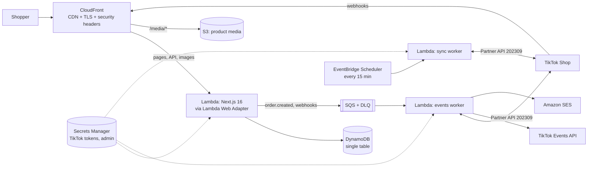

# Mall of Anitoy — storefront

E-commerce website for **[Mall of Anitoy (@leduyenminh)](https://www.tiktok.com/@leduyenminh)**, the TikTok shop for chibi anime figures (Frieren, Fern, Stark, Kinako/Osakana neko…). It runs serverless on AWS and stays in sync with **TikTok Shop**.

- **Four themes**: Light, Dark, **Windows 95** (bevelled windows, title bars, taskbar with a working Start menu) and **Frutiger Aero** (sky, bubbles, frosted glass, glossy buttons). The theme follows the system by default, is saved per visitor, and is applied before first paint.
- **Vietnamese first, English second**: `/` is Vietnamese, `/en` is English. Prices are in VND, addresses use the 34 provinces in place since 1 July 2025, and payment is COD plus VietQR bank transfer.
- **Built for selling**: pages are CDN-cached and incrementally regenerated, images go through AVIF/WebP optimisation, and pages carry JSON-LD (Product, Breadcrumb, FAQ, OnlineStore), a sitemap and hreflang. The shop also has instant search and filters, a free-shipping progress meter, low-stock badges, quick-add, a sticky mobile buy bar, guest checkout and click-to-play TikTok videos.
- **TikTok Shop integration**: the catalog and inventory sync from TikTok Shop, website orders update TikTok inventory, and TikTok orders update website stock through webhooks. Every product has a "Buy on TikTok Shop" link, and conversions are reported through the TikTok Pixel (after consent) and the Events API.
- **The shop's own TikTok videos on every product**: product photos are the shop's video covers, each product shows its videos with TikTok's view counts, and cards carry a "▶ views" badge that opens a preview. Videos always play in **TikTok's official embed player**, the only way a play on this site can reach TikTok's own counters (a re-hosted copy never would). TikTok does not document whether embedded plays are added to the public count. View counts on the site are refreshed from the TikTok Display API once the account is connected.
- **Sold-out items stay listed**, marked "Hết hàng" and still browsable, with a pointer to TikTok Shop.

> **Before launch:** the starter catalog in `src/data/seed-products.ts` is built from the 72 videos on @leduyenminh: product photos are the video covers and the view counts are TikTok's numbers on 16 Oct 2026. Prices, stock and descriptions are placeholders (older lines are set to sold out). Connect TikTok Shop and run a sync to replace them with the real listings and listing photos. Also review the shipping and returns wording in `src/i18n/dictionaries/*.ts`.

---

## Architecture



| Concern | How it is handled |
| --- | --- |
| Rendering | Next.js App Router. Catalog and product pages use ISR (`revalidate`), cached by CloudFront through `s-maxage` / `stale-while-revalidate`. Order and admin pages are dynamic and `no-store`. |
| Lambda specifics | A custom in-memory cache handler (`cache-handler.mjs`), because Lambda's filesystem is read-only. Responses stream through Function URL response streaming. CloudFront adds a secret origin header and the app rejects requests without it. |
| Data | DynamoDB single table: products (SKUs stored as a map, so one product can be decremented atomically), orders, webhook dedupe markers with TTL, and sync state. A local JSON store is used in development. |
| Consistency | An order and its stock reservation are written in one DynamoDB transaction, so overselling is impossible. Checkout always re-prices on the server. |
| Async work | SQS with partial-batch failures, a dead-letter queue after 5 attempts, and idempotent handler steps. |
| Observability | Structured JSON logs (CloudWatch Logs Insights), plus alarms for the DLQ, storefront errors and sync failures, sent to SNS email. |
| Cost | Scales to zero. At small-shop traffic most of the cost is Secrets Manager (3 secrets) and ECR storage; CloudFront, Lambda and DynamoDB usually stay within or near the free tier. |

### How TikTok Shop sync works

| Direction | Mechanism |
| --- | --- |
| TikTok → website catalog | The sync worker refreshes the OAuth token, then lists active products (`/product/202309/products/search`) and fetches details. It maps the listing (title, description reduced to safe text, SKUs, price, inventory), mirrors images to S3, and archives products that were delisted. The slug, translations, videos and merchandising you set on the website are kept. |
| TikTok order → website stock | The `ORDER_STATUS_CHANGE` and `PRODUCT_STATUS_CHANGE` webhooks are verified with HMAC and queued. The worker then re-reads the affected listings and updates stock. |
| Website order → TikTok stock | `order.created` makes the worker read TikTok's current quantity and write `quantity − n` (`inventory/update`). Cancelling an order puts the stock back the same way. |
| Ads attribution | The TikTok Pixel loads only after consent: ViewContent, AddToCart, InitiateCheckout, PlaceAnOrder. The server sends the same events through the Events API with the same `event_id`, so TikTok de-duplicates them. |

## Payments

Stripe does not support merchants in Vietnam, so checkout offers the methods Vietnamese shoppers actually use:

- **COD**, which is the default. The order is reserved and the seller confirms it in `/admin`.
- **VietQR bank transfer**, offered when `NEXT_PUBLIC_VIETQR_*` is set. The order page shows a QR code with the amount and the order code as the transfer memo, and the seller marks the order paid in `/admin`.
- **Buy on TikTok Shop**, on every product, for shoppers who want to use TikTok vouchers.

Payment gateways such as PayOS, VNPay or MoMo can be added next to `paymentMethod` in `src/lib/orders.ts`.

---

## Run locally

Requirements: Node.js 22+ (24 recommended).

```bash
npm install
```

```bash
cp .env.example .env.local
```

Set `ADMIN_PASSWORD` in `.env.local`, then start the dev server:

```bash
npm run dev
```

Open http://localhost:3000, and the back office at http://localhost:3000/admin (user `admin`). Data is stored in `.data/store.json`; delete it to reset to the sample catalog.

Other commands:

| Command | What it does |
| --- | --- |
| `npm run check` | Lint, typecheck and unit tests |
| `npm run build && npm start` | Production build |
| `npm run media <folder>` | Rebuild product photos, video posters and icons from downloaded TikTok covers + avatar |
| `npm run sync` | Run a TikTok Shop sync from the CLI, using `.env.local` |
| `docker compose up --build` then `npm run db:init` | Production container plus DynamoDB Local |

## Deploy to AWS

Requirements: an AWS account, the AWS CLI configured, and Docker running (the storefront image is built during deploy). The default region is `ap-southeast-1` (Singapore), the closest full-service region to Vietnam.

```bash
cd infra && npm install
```

```bash
npx cdk bootstrap
```

```bash
npx cdk deploy
```

To use your own domain, request an ACM certificate in **us-east-1** first:

```bash
npx cdk deploy -c domainName=shop.example.vn -c certificateArn=arn:aws:acm:us-east-1:123456789012:certificate/abc -c alarmEmail=you@example.com
```

Optional context: `sesFromEmail` (a verified SES sender, which enables order emails) and `sellerEmail` (receives a notification for each new order). Public storefront settings such as the pixel id, VietQR account and contact details are read from `NEXT_PUBLIC_*` environment variables at deploy time; see `.env.example`.

The stack prints `SiteUrl`, `TikTokWebhookUrl`, `TikTokRedirectUrl`, `TikTokSecretArn` and `AdminSecretArn`. To read the admin password:

```bash
aws secretsmanager get-secret-value --secret-id <AdminSecretArn> --query SecretString --output text
```

**CI/CD:** `.github/workflows/ci.yml` runs lint, typecheck, tests, build and `cdk synth`. `.github/workflows/deploy.yml` deploys `main` using GitHub OIDC; set the `AWS_DEPLOY_ROLE_ARN` secret and the repository variables listed in the file.

## Connect TikTok Shop

1. In **[TikTok Shop Partner Center](https://partner.tiktokshop.com)**, create an app for your shop (Vietnam market). Request the API scopes for **products** (read and update inventory), **orders** (read), **seller authorization** and **events/webhooks**.
2. Set the app's **redirect URL** to the stack output `TikTokRedirectUrl` (`https://<site>/api/admin/tiktok/callback`).
3. Set the **webhook URL** to `TikTokWebhookUrl` (`https://<site>/api/webhooks/tiktok`) and subscribe to order status, reverse order status, product status and seller deauthorization events.
4. Store the app credentials (this replaces the secret's JSON, so do it before connecting):

   ```bash
   aws secretsmanager put-secret-value --secret-id <TikTokSecretArn> --secret-string '{"appKey":"…","appSecret":"…","serviceId":"…","eventsAccessToken":"…"}'
   ```

5. Open `/admin`, click **Connect TikTok Shop**, approve access, then click **Sync catalog now**. After that, a sync runs every 15 minutes and webhooks deliver changes in near real time.
6. Optional: create a **TikTok Pixel** in TikTok Ads Manager. Put its id in `NEXT_PUBLIC_TIKTOK_PIXEL_ID` and an Events API token in `eventsAccessToken`.

For local development, put `TIKTOK_APP_KEY`, `TIKTOK_APP_SECRET` and `TIKTOK_SERVICE_ID` in `.env.local`. Tokens are saved to `.data/tiktok.json`.

## Connect the TikTok account (video view counts)

View counts and new videos come from the **TikTok Display API**, a separate app from TikTok Shop:

1. In **[TikTok for Developers](https://developers.tiktok.com)**, create an app with **Login Kit** and the **Display API** (scopes `user.info.basic` and `video.list`).
2. Set its redirect URI to `https://<site>/api/admin/tiktok/videos/callback`.
3. Add `displayClientKey` and `displayClientSecret` to the TikTok secret (or `TIKTOK_DISPLAY_CLIENT_KEY` / `TIKTOK_DISPLAY_CLIENT_SECRET` in `.env.local`).
4. In `/admin`, click **Connect TikTok account** and sign in as @leduyenminh. Views refresh on every sync (every 15 minutes); new videos appear on the home page, with their covers copied to S3.

New videos are not linked to products automatically: add their ids to a product's `tiktokVideoIds`.

## Project structure

```
src/
  app/[lang]/…          pages (home, shop, product, cart, checkout, order, about, help, admin)
  app/api/…             orders, cart quote, TikTok webhook, admin (sync, order actions, OAuth)
  proxy.ts              locale routing, admin Basic auth, CloudFront origin verification
  components/           UI (cart, catalog, product, theme picker, Win95 taskbar, pixel/consent)
  i18n/                 vi/en dictionaries and locale helpers
  lib/
    repo/               Repository interface, local JSON store and DynamoDB implementations
    tiktok/             request signing, OAuth, API client, mapper, sync, Events API
    checkout/           quoting, validation, provinces
    events/             SQS publish and idempotent handlers
    orders.ts           checkout and order workflow
  styles/               design tokens and the Win95 / Aero theme layers
  workers/              Lambda handlers (events, sync)
infra/                  AWS CDK app (TypeScript)
cache-handler.mjs       ISR cache for Lambda
Dockerfile              runner (any container host) and lambda targets
```

## Security notes

- Order pages need a random token in the link, because orders hold names, phone numbers and addresses. These pages are never cached or indexed.
- `/admin` uses HTTP Basic auth with a generated secret. Admin mutations also require same-origin JSON requests, which protects them from CSRF.
- TikTok webhooks are verified with HMAC-SHA256 over the raw body and de-duplicated by notification id.
- TikTok product descriptions are reduced to plain text and never rendered as HTML.
- To add WAF rate limiting in front of CloudFront, attach a web ACL created in us-east-1 to the distribution.
